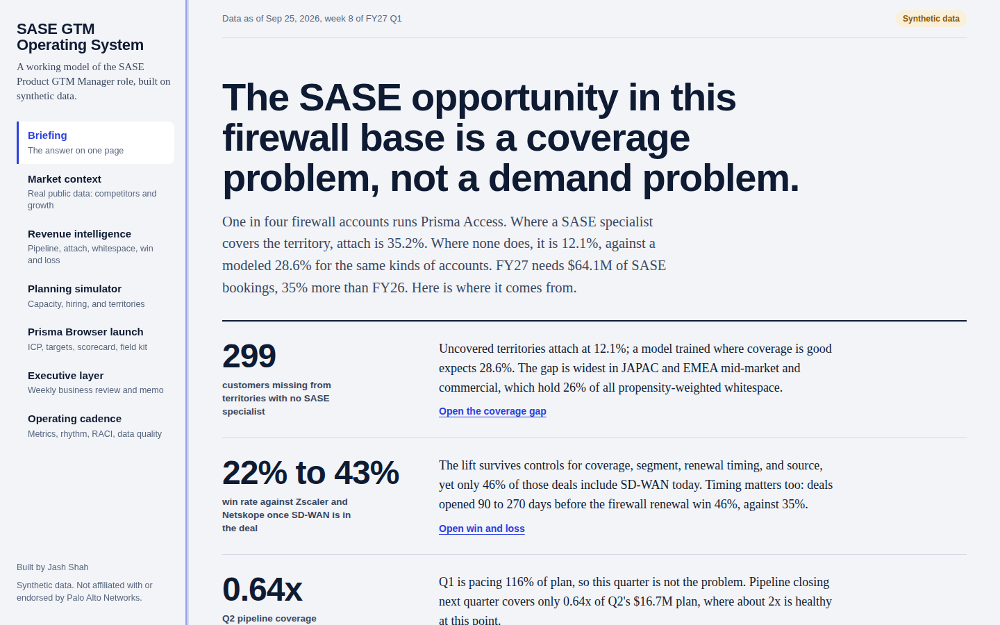
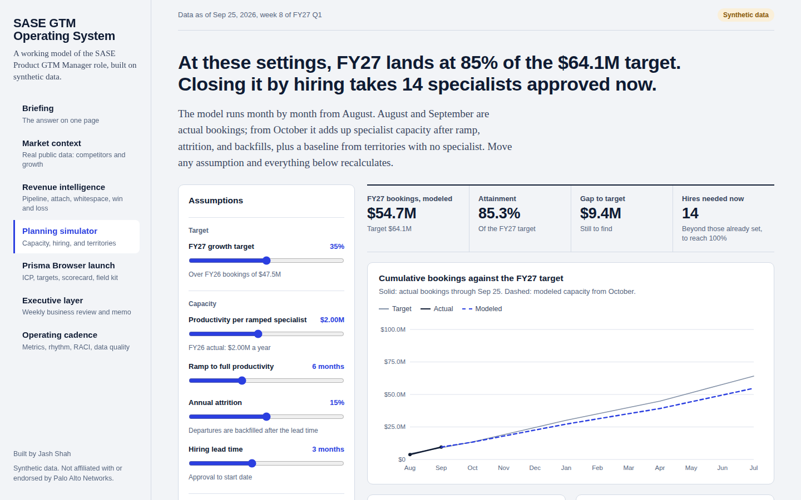
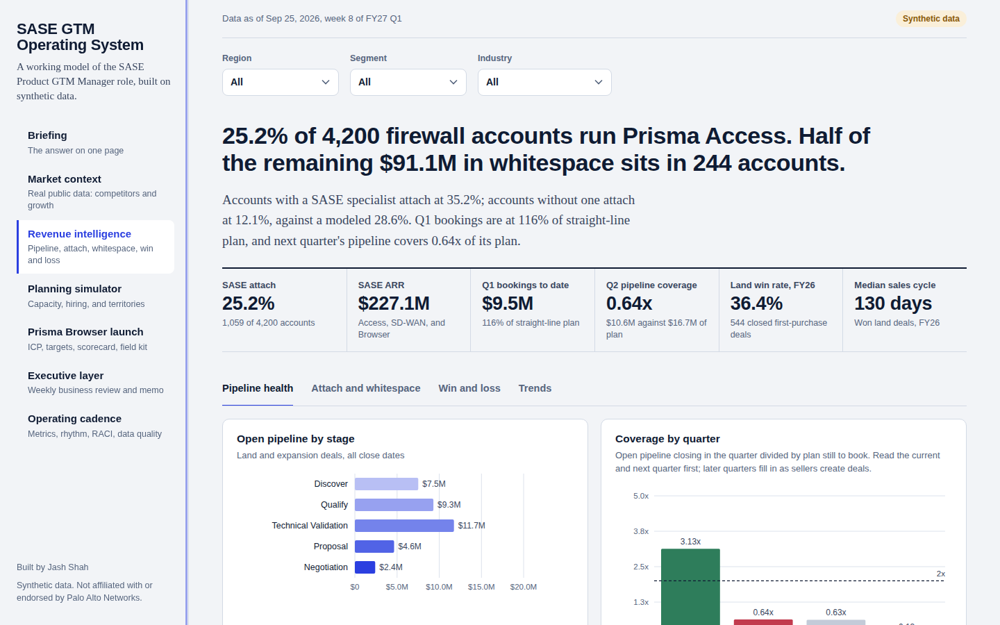
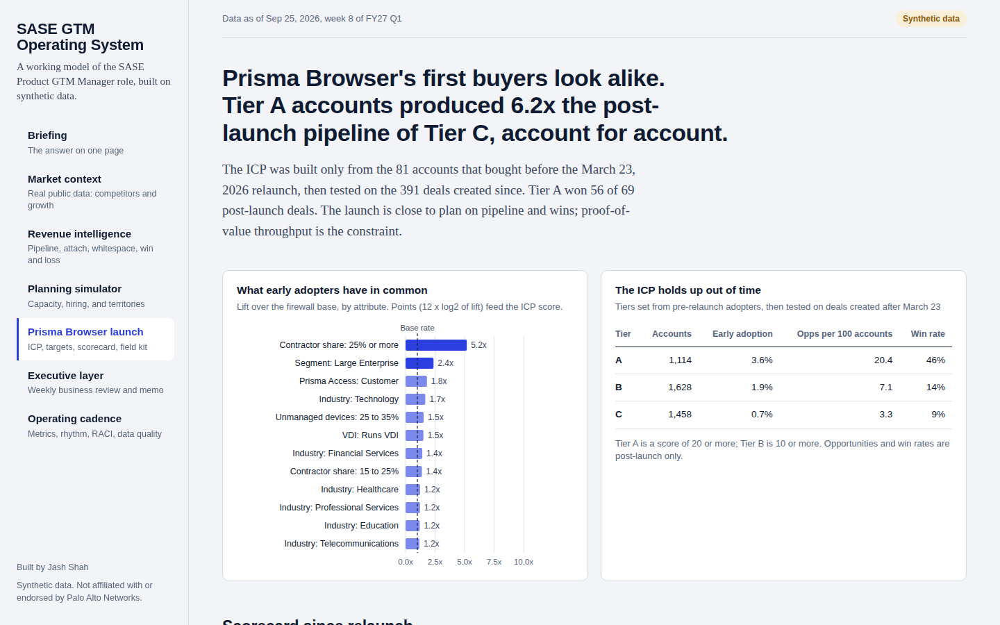
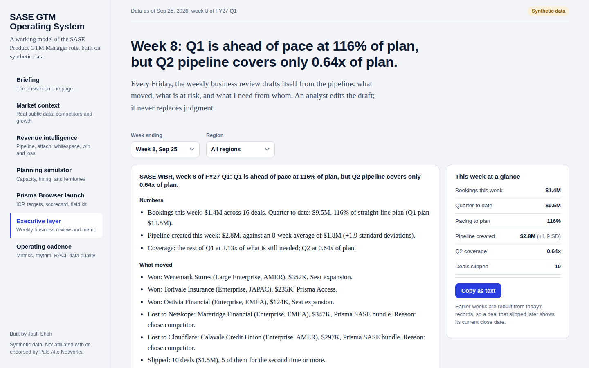
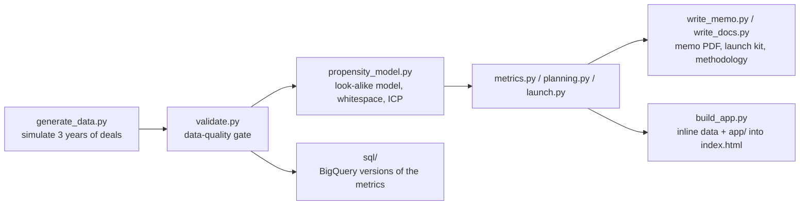

# SASE GTM Operating System

A working model of the **SASE Product GTM Manager** role: revenue intelligence, capacity planning,
launch readiness, executive reporting, and operating cadence, in one self-contained web app.

**Live demo:** `https://jashshah127.github.io/sase-gtm-os/` (see [Deploy](#deploy-to-github-pages-free))



> **Independent portfolio project by Jash Shah.** All account, deal, and seller data is synthetic; the Market context page is the exception and uses only real, public data.
> Public Palo Alto Networks figures are used only to calibrate scale and growth, and are cited in
> [docs/methodology.md](docs/methodology.md). Not affiliated with or endorsed by Palo Alto Networks;
> product and company names are used only to describe the market.

## The answer first

In a synthetic book of 4,200 next-generation firewall accounts (FY27 Q1, week 8):

1. **It's a coverage problem, not a demand problem.** Territories without a SASE specialist attach at
   12.1% against a modeled 28.6%: about 299 customers we'd expect and don't have, concentrated in JAPAC
   and EMEA mid-market and commercial. Half of the $91.1M in propensity-weighted whitespace sits in 244 accounts.
2. **The SD-WAN bundle wins competitive deals.** Against Zscaler and Netskope, deals with SD-WAN win 43%
   versus 22%, and the effect holds after controlling for coverage, segment, renewal timing, and source.
   Deals opened 90 to 270 days before the firewall renewal win 46% versus 35%.
3. **Q2 is the risk, not Q1.** Q1 is pacing 116% of plan, but Q2 pipeline covers 0.64x of plan.

**The market (real data):** Palo Alto Networks' SASE ARR grew 40% against 21% for the SASE market
(Dell'Oro), and Dell'Oro expects single-vendor SASE to take 90% of a $17B market by 2029. See the
Market context page; every figure links to its source.

**The plan:** current capacity reaches 85% of the $64.1M FY27 target. Hiring alone would take
14 specialists ($2.5M this year). Two win-rate plays reach 95% at no headcount cost, and with
**4 hires** the plan reaches 100%. Full reasoning in the [one-page memo](docs/executive_memo.pdf) and the
[12-slide readout deck](docs/SASE_GTM_readout.pptx), which has speaker notes on every slide.

## What's inside

| Responsibility in the job description | Module | What it does |
|---|---|---|
| Market sizing and competitive context | Market context (real data) | Competitor ARR from earnings releases, Dell'Oro SASE market growth, and panels for SEC filings, CISA exploited vulnerabilities, and Census business counts |
| Performance analytics and revenue opportunities | Revenue intelligence | Pipeline health, attach heatmap, territory coverage gap, whitespace ranking, win/loss with statistical controls; filter by region, segment, industry |
| GTM strategy and planning | Planning simulator | Monthly capacity model with ramp, attrition, and backfills; hiring solver; scenarios; pipeline math; territory designer that balances accounts by opportunity value |
| Product launch and field enablement | Prisma Browser launch | ICP from pre-launch adopters, validated out of time; Tier A target list; weekly launch scorecard; field kit (positioning, battlecard, discovery guide) |
| Executive presentations and dashboards | Executive layer | A weekly business review that drafts itself for any week and region; the one-page memo |
| Cross-functional operating cadence and mentoring | Operating cadence | Searchable metric dictionary, operating rhythm, FY28 planning calendar, RACI, data-quality gate, analyst onboarding plan |

| Planning simulator | Revenue intelligence |
|---|---|
|  |  |
| **Prisma Browser launch** | **Executive layer** |
|  |  |

## Quickstart

The app is a single file. Open `index.html` in any browser; nothing to install.

To rebuild everything from scratch (about 30 seconds, deterministic):

```bash
python -m venv .venv && source .venv/bin/activate
pip install -r requirements.txt
python pipeline/run_all.py        # data, quality gate, model, metrics, docs, memo, index.html
```

To run the end-to-end browser test (renders every module, checks the app against the pipeline,
refreshes the screenshots):

```bash
pip install -r requirements-dev.txt && playwright install chromium
python tests/check_app.py
python tests/test_market.py      # offline tests for the market module (pytest also works)
```

## Deploy to GitHub Pages (free)

1. Create a public repository named `sase-gtm-os` and push this folder to it.
2. In the repository, open **Settings > Pages**, set **Source** to *Deploy from a branch*, choose
   `main` and `/ (root)`, and save.
3. After a minute the app is live at `https://jashshah127.github.io/sase-gtm-os/`.

Before publishing, add your links in `pipeline/config.py` (`AUTHOR_LINKS`) and run
`python pipeline/build_app.py`. Empty links are hidden.

## How it's built



- **Python pipeline** (`pipeline/`): pandas, NumPy, scikit-learn. Seeded, so every run reproduces the
  same data and numbers.
- **Web app** (`app/` compiled into `index.html`): vanilla JavaScript with hand-written SVG charts and
  no dependencies, so it loads instantly and works offline. The app recomputes every metric live from
  the inlined data, which is why filters and sliders respond immediately.
- **Warehouse layer** (`sql/`): BigQuery Standard SQL for pipeline health, attach, win/loss,
  whitespace, coverage gap, and capacity, plus a loader script for the free BigQuery sandbox.

## Why the numbers can be trusted

- **One definition per metric.** [docs/operating_cadence/metric_dictionary.md](docs/operating_cadence/metric_dictionary.md)
  is generated from the same source as the app's dictionary.
- **A data-quality gate.** Known issues (duplicate accounts, orphan deals, impossible dates, zero
  amounts) are injected into the raw export, and the pipeline fails unless every one is caught.
  31 records are quarantined before they can reach a metric.
- **The app and the pipeline agree.** `tests/check_app.py` compares the browser's live KPIs and the
  JavaScript capacity engine against the Python reference: attach, ARR, bookings, coverage, win rate,
  cycle time, and all five planning scenarios.
- **Real where it can be.** The Market context page uses only public data, split into hand-curated figures
  (`data/curated/`, every row with its source URL) and machine-fetched datasets (`data/public/`). Each file is checked
  against a fixed format before anything is drawn, and `tests/test_market.py` covers every parsing path.
- **Honest modeling.** The propensity model is trained only on specialist-covered territories, so its
  score means "attach under good coverage." Logistic regression beat gradient boosting on
  cross-validated AUC (0.76 against 0.73) and is explainable, so it's the one used. Every planted
  pattern in the synthetic data is disclosed in the methodology.

## Repository map

```
index.html                 the app (built; open or deploy this)
app/                       app source: styles.css, core.js, charts.js, views_a.js, planning.js, views_b.js, main.js
pipeline/                  data generation, validation, model, metrics, planning, docs, memo, build
sql/                       BigQuery schema, six analysis queries, load_to_bigquery.sh
data/curated/              real, hand-curated competitor and market figures with source URLs
data/public/               real datasets fetched by pipeline/fetch_public_data.py (added via docs/cto_brief.md)
data/raw/                  synthetic export with injected data-quality issues
data/clean/                validated tables and quarantined records
data/processed/            scored accounts and JSON outputs used by the app and docs
docs/executive_memo.pdf    the one-page memo (also .md)
docs/SASE_GTM_readout.pptx the readout deck with speaker notes
deck/                      deck generator: python deck/deck_data.py, then node deck/build_deck.js (npm install in deck/)
docs/launch_kit/           Prisma Browser ICP, positioning, battlecard, discovery guide, scorecard
docs/operating_cadence/    metric dictionary, RACI, operating calendar, WBR template, analyst onboarding
docs/methodology.md        how the data is generated, every planted pattern, methods, limitations, sources
docs/interview_playbook.md how to present this project and answer the hard questions
tests/check_app.py         headless-browser test and screenshot generator
tests/test_market.py       offline tests for the market module (fake fixtures in tests/fixtures_market/)
docs/cto_brief.md          spec for the public-data fetch script and weekly refresh workflow
```

## Limitations

The data is synthetic, prices are illustrative, stage history is simplified to the current stage,
and specialist productivity credits all covered-territory bookings to specialists. The coverage
effect in real data could partly reflect how territories were chosen; the right test is a staggered
coverage pilot. Details in [docs/methodology.md](docs/methodology.md).
